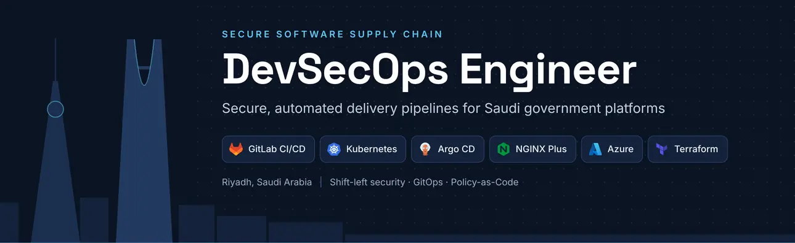

<h1 align="center">Islam Handousa</h1>

<b>DevSecOps Engineer</b> · Riyadh, Saudi Arabia 
<i>I build delivery pipelines where security is a gate, not an afterthought.</i>

  
  
  

---

DevSecOps Engineer with **9+ years in software engineering** and **3+ years securing CI/CD pipelines and Kubernetes platforms for Saudi government entities**.

- **Kafaat Digital Transformation (KDX)** · DevSecOps Engineer on the General Authority of Civil Aviation (GACA) account, where nothing reaches production except through protected merge requests, pipeline security gates and approved change requests.
- **Axelerated Solutions** · NGINX Engineer (contract) for a Saudi government entity: NGINX Ingress Controller and NGINX Instance Manager across 6 Kubernetes clusters.

A developer background in .NET Core and Next.js means vulnerabilities get fixed in code, not just reported.

## What I do

- **Shift-left security** · SAST, DAST, SCA and container image scanning as mandatory gates in GitLab CI/CD and Azure DevOps.
- **Reusable, restricted pipeline templates** · teams consume shared pipelines without seeing or altering the security logic.
- **NGINX and Kubernetes hardening** · against real audit findings: TLS, security headers, least-privilege RBAC, policy as code, runtime security.
- **GitOps change control** · every production change, from application fixes to NGINX routes, ships as a reviewed merge request deployed by pipeline.

## Impact

| Result | How |
| --- | --- |
| **95% less production downtime** at GACA | Every change moved to reviewed merge requests and pipeline-driven, zero-downtime deployments |
| **~15 minutes** to onboard a new application's pipeline | Restricted, reusable pipeline templates with security gates built in |
| **6 of 6 audit findings closed**, zero downtime | NGINX hardening across 6 clusters: outdated version, clear-text HTTP, TLS 1.0/1.1, weak CSP, missing HSTS, version disclosure |

## Tech stack

**CI/CD & GitOps** 

**Application & supply-chain security** 

**Containers & traffic** 

**Cloud, IaC & observability** 

**Identity, platforms & code** 

## Selected work

- **NGINX Ingress hardening for a Saudi government entity** · Axelerated Solutions, 2026 
  NGINX Ingress Controller and NGINX Instance Manager across 6 Kubernetes clusters. Fixed vulnerable ConfigMap configuration, closed all six audit findings, upgraded to NGINX Plus R37 LTS with zero downtime, migrated the controller to a DaemonSet and fixed a hostPort rollout deadlock. Everything shipped through GitLab merge requests and Azure DevOps pipelines.
- **GACA delivery platform** · KDX, 2025 to present 
  CI/CD for 9 applications with GitLab as the single source of truth, restricted pipeline templates, an NGINX reverse proxy that serves 5 apps under gaca.gov.sa subpaths, and SAML2 single sign-on via ADFS.
- **DevSecOps reference platform** · personal lab, 2026 
  A 16-VM production-style design: F5 BIG-IP at the edge, NGINX App Protect WAF in the DMZ, Palo Alto internal firewall, GitLab Ultimate CI/CD with Harbor, Argo CD and signed-image enforcement through Kyverno, HashiCorp Vault, Microsoft Entra ID SSO, and a 3-node kubeadm cluster with Falco, Prometheus, Grafana, Loki and Velero.
- **SNAP, Saudi National Air Navigation Plan** · GACA Vision 2030, 2023 to 2025 
  Full-stack and DevOps on GACA's airspace-modernization portal: .NET Core and Next.js on Azure, SQL Server, NGINX load balancing.
- **Yalla Shipping** · freelance, 2023 
  Self-hosted GitLab and a private Docker registry, CI/CD with SonarQube quality gates, Kubernetes behind NGINX, Grafana monitoring.

## Certifications

<table>
  <tr>
    <td align="center" width="200">
      <a href="https://learn.microsoft.com/api/credentials/share/en-us/IslamHandousa/5771314EE934CDDD?sharingId=E3436C612FCBE8C6" title="Microsoft Certified: Azure Administrator Associate">
         
        <b>AZ-104</b> 
        Azure Administrator Associate
      </a>
    </td>
    <td align="center" width="200">
      <a href="https://www.credly.com/badges/a2c8e15d-fd36-405e-9549-5db7dcf8e388" title="GitLab Solutions Architect Core Verified Associate">
         
        <b>GitLab Solutions Architect</b> 
        Core Verified Associate
      </a>
    </td>
    <td align="center" width="200">
      <a href="https://www.credly.com/badges/ba935f70-4ca1-4119-a930-18e339f533cd" title="AWS Partner: DevOps Essentials">
         
        <b>AWS Partner</b> 
        DevOps Essentials
      </a>
    </td>
    <td align="center" width="200">
      <a href="https://www.credly.com/badges/4f350826-61d0-4e65-b04b-e2e3250d4958" title="AWS Partner: Technical Accredited">
         
        <b>AWS Partner</b> 
        Technical Accredited
      </a>
    </td>
  </tr>
</table>

**In progress:** Microsoft Certified: DevOps Engineer Expert (AZ-400), then Certified Kubernetes Administrator (CKA).

**Also:** DevSecOps Diploma, IT Gate Academy · Registered Engineer, Saudi Council of Engineers

**Education:** Bachelor's degree in Computer Science, Misr Higher Institute for Commerce and Computers (MET), Mansoura, Egypt, 2017

## Contact

- Email · [ihandousa@outlook.com](mailto:ihandousa@outlook.com)
- LinkedIn · [linkedin.com/in/ihandousa](https://www.linkedin.com/in/ihandousa/)
- Credly · [credly.com/users/islam-handousa](https://www.credly.com/users/islam-handousa)
